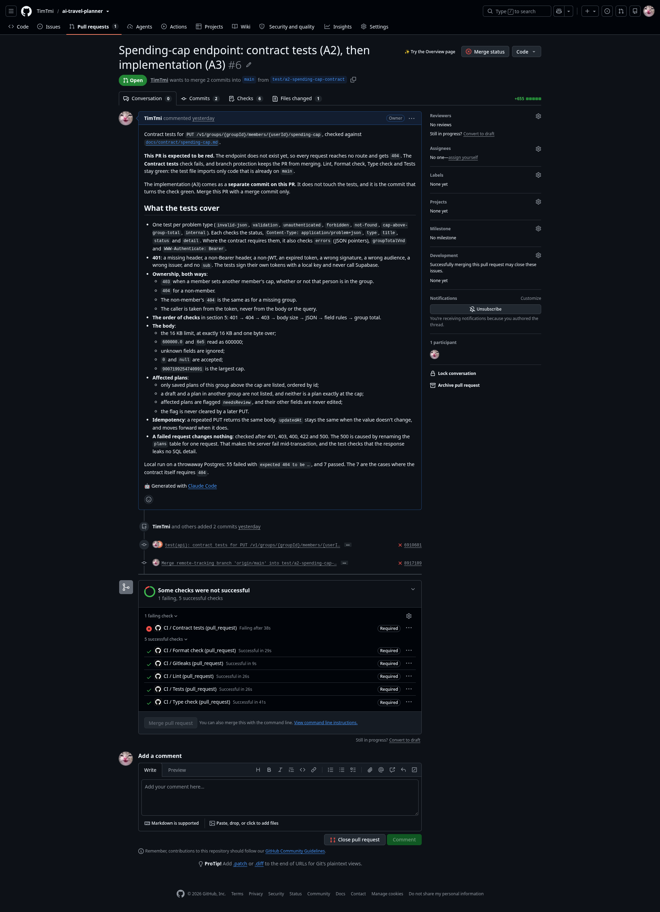

# PA#2 — Harness and quality gate

Team: 23127228 Phạm Văn Minh, 23127395 Trần Anh Khoa.

| Evidence                    | Link                                                                                                                                                                                              |
| --------------------------- | ------------------------------------------------------------------------------------------------------------------------------------------------------------------------------------------------- |
| Repository                  | https://github.com/TimTmi/ai-travel-planner                                                                                                                                                       |
| Protected-branch settings   | [`docs/pa2/branch-protection.png`](docs/pa2/branch-protection.png)                                                                                                                                |
| Blocked pull request        | [PR #6](https://github.com/TimTmi/ai-travel-planner/pull/6), screenshot [`docs/pa2/blocked-pr.png`](docs/pa2/blocked-pr.png)                                                                      |
| Commit that turned it green | [`29305d8`](https://github.com/TimTmi/ai-travel-planner/commit/29305d834a0a8569beb2a9c185cedc263e47cbc1), [run 45413730945](https://github.com/TimTmi/ai-travel-planner/actions/runs/45413730945) |
| CI run for the `pa2` tag    | [Actions runs for `pa2`](https://github.com/TimTmi/ai-travel-planner/actions?query=branch%3Apa2)                                                                                                  |
| Deliberate contract break   | [PR #11](https://github.com/TimTmi/ai-travel-planner/pull/11), [run 45420401170](https://github.com/TimTmi/ai-travel-planner/actions/runs/45420401170)                                            |

## Branch protection

`main` requires a pull request and six passing checks: Lint, Format check, Type check, Tests, Contract tests and Gitleaks. Branches must be up to date with `main` before merging, nobody can bypass the rules (admins included), and force pushes and deletions are blocked. Only merge commits are allowed, so the commits below stay in `main`'s history.

Since protection was turned on, every change has reached `main` through a pull request. `git log --first-parent main` shows only PR merge commits from PR #2 onwards; the five commits before them are the P0 scaffold and CI, which had to exist before there were checks to require.

## The blocked pull request

[PR #6](https://github.com/TimTmi/ai-travel-planner/pull/6) added the contract tests for `PUT /v1/groups/{groupId}/members/{userId}/spending-cap` in commit [`6910681`](https://github.com/TimTmi/ai-travel-planner/commit/6910681c66b08bc3f81880b29efa3c8b48d203cc), before the endpoint existed. The required Contract tests check went red ([run 45053094428](https://github.com/TimTmi/ai-travel-planner/actions/runs/45053094428), and again after merging `main` into the branch, [run 45323832020](https://github.com/TimTmi/ai-travel-planner/actions/runs/45323832020): 55 failed, 11 passed), and GitHub kept the merge button locked.

## The commit that turned it green

[`29305d8`](https://github.com/TimTmi/ai-travel-planner/commit/29305d834a0a8569beb2a9c185cedc263e47cbc1) implements the endpoint and changes only `apps/api/src`. All six checks passed on it ([run 45413730945](https://github.com/TimTmi/ai-travel-planner/actions/runs/45413730945)), and PR #6 was merged with a merge commit ([`a723a38`](https://github.com/TimTmi/ai-travel-planner/commit/a723a384045aff61e83455361aa67e770d698c1e)).

Before it, [`a3ebcb6`](https://github.com/TimTmi/ai-travel-planner/commit/a3ebcb6f2d8d2b1adb3a50e543b66b97e6fddb3e) corrected one A2 test that contradicted contract §4: it expected no affected plans at a 700,000 VND cap, though a saved plan at 750,000 must be listed. That commit changes only that test, contains no code, and CI stayed red on it ([run 45408728368](https://github.com/TimTmi/ai-travel-planner/actions/runs/45408728368)). Details are in the A2 entry in [`AI-LOG.md`](AI-LOG.md).

## The deliberate contract break

[PR #11](https://github.com/TimTmi/ai-travel-planner/pull/11) removed the ownership check, so any member could set another member's cap. Contract §2 says that request gets `403 forbidden` and changes nothing. The commit ([`0ad6241`](https://github.com/TimTmi/ai-travel-planner/commit/0ad6241fb1ed20d451f3e39e7e73ce748fb7d0bb)) changes only `apps/api/src/groups/spending-cap.controller.ts`; the contract and the tests are untouched.

Lint, Format check, Type check, Tests and Gitleaks all passed. Contract tests went red on the six ownership-rule tests ([run 45420401170](https://github.com/TimTmi/ai-travel-planner/actions/runs/45420401170)), the required check blocked the merge, and the PR was closed unmerged.

## The `pa2` tag

`pa2` is on the merge commit of the pull request that added this file. Pushing the tag runs CI (the workflow runs on `pa*` tags); its run is listed under [Actions runs for `pa2`](https://github.com/TimTmi/ai-travel-planner/actions?query=branch%3Apa2).
